# B站热门视频与评论分析

> 数据计算及应用专业 · 个人项目
>
> 完整链路：数据爬取 → 数据清洗与人工情感标注 → 探索性可视化 → 情感分类建模 → 评论主题聚类
> → 大模型微调（LoRA）与深度学习基线 → 检索增强问答（RAG）→ 工具调用 Agent

## 一、项目简介

本项目以 B 站「入站必刷」热门视频为研究对象，采集热门视频及其评论区热门评论，构建结构化数据集，
并在此基础上完成四件事：

1. **视频指标分析**：从播放、点赞、投币、收藏、分享、评论六个维度出发，构造互动率类衍生指标，
   分析热门视频的流量与互动规律，并做可视化呈现；
2. **评论挖掘**：对评论做情感三分类（负面 / 中性 / 正面）的监督学习建模，对比 6 种传统机器学习模型；
   同时对评论做无监督聚类，挖掘评论区的主要讨论主题；
3. **大模型微调与深度学习**：用 LoRA 微调 Qwen2.5-0.5B-Instruct 做同一套情感分类任务，
   并自己搭一个 TextCNN 作为深度学习基线，三者用同一批 1813 条测试数据对比；
4. **检索增强问答与 Agent**：把 9061 条评论建成检索索引，用 LangChain 的 LCEL 串成「检索 → 拼材料 → 大模型作答」的 RAG，
   再把统计、检索、排序、预测 5 个函数包成 LangChain 工具，用 `create_tool_calling_agent` + `AgentExecutor`
   做成能自己选工具回答问题的 Agent（需要配置大模型 API Key）。

项目覆盖「爬虫 → 清洗 → 标注 → 特征工程 → 建模调参 → 聚类 → 可视化 → 微调 → RAG / Agent」完整流程，代码按模块分目录组织。

**核心结果**

- 数据规模：98 个热门视频、9700 条热门评论（每个视频评论区按热度取前 100 条），清洗 + 人工标注后得到 9061 条建模样本；
- 情感分类：KNN、逻辑回归、随机森林、XGBoost、朴素贝叶斯、SVM 六个模型对比，逻辑回归效果最好
  （测试集准确率 **0.6702**、macro-F1 **0.6294**）；
- 大模型微调：LoRA 只训 0.44% 的参数（8.3 MB 适配器），把 Qwen2.5-0.5B 的准确率从 0.5433 提到 **0.6415**，
  macro-F1 **0.6246**，与机器学习基线基本持平；TextCNN 基线 0.6365 / 0.5669；
- 主题聚类：TF-IDF + SVD + KMeans 得到 5 个可解释主题，最大的「玩梗打卡」占 54.2%；
- 可直接调用：向量器与模型已打包成 `model/ml/评论情感分类.pkl`，新评论用 `hot_comment_predict.py` 就能预测情感。

## 二、项目结构

```
bilibili-hot-video-comment-analysis/
├── README.md                                      # 项目说明（本文件）
├── LICENSE                                        # 开源协议（MIT）
├── requirements.txt                               # 依赖与版本
├── .gitignore                                     # 排除模型文件、含真实用户信息的原始评论数据
├── data/
│   ├── hot_video.csv                              # 视频原始数据（爬虫输出）
│   ├── hot_video_processed.csv                    # 视频衍生指标数据
│   ├── hot_comments.csv                           # 评论原始数据（爬虫输出，含真实用户名 / UID，仅本地保留）
│   ├── hot_comments_clean.csv                     # 评论清洗数据（过滤点赞数少、过短的评论，仅本地保留）
│   ├── hot_comments_anonymized.csv                # 评论原始数据的脱敏版（可对外发布）
│   ├── hot_comments_clean_anonymized.csv          # 评论清洗数据的脱敏版（与上表共用同一套假名）
│   ├── hot_comments_clean_processed.csv           # 评论正则清洗后的数据（建模输入）
│   ├── hot_comments_clean_processed_label.csv     # 人工标注后的数据（建模输入 + 标签）
│   ├── hit_stopwords.txt                          # 停用词表（哈工大停用词表 + 自定义补充）
│   ├── fig/                                       # 图表输出（按来源分五个子目录，共 21 张）
│   │   ├── analysis/                              # 探索性分析的 10 张（7.1 节）
│   │   ├── ml/                                    # 六模型对比与混淆矩阵 2 张（7.2 节）
│   │   ├── cluster/                               # 词云、选 k 曲线、聚类散点 5 张（7.3 节）
│   │   ├── dl/                                    # TextCNN 训练曲线（7.5 节）
│   │   └── finetune/                              # LoRA 微调的三张对比图（7.4 节）
│   └── finetune/                                  # LoRA 微调用的对话数据与预测明细（运行后生成，已 gitignore）
├── output/                                        # 运行结果文本（随仓库发布）与训练日志（已 gitignore）
│   ├── hot_comment_ml_model_result.txt            # 6 个模型默认参数下的评估结果
│   ├── hot_comment_ml_model_assessment_result.txt # 网格搜索 + 交叉验证后的评估结果
│   ├── hot_comment_wordcloud_clustering_result.txt # 词云词频 + 5 个簇的主题词
│   ├── hot_comment_textcnn_result.txt             # TextCNN 每轮损失 / 验证准确率 / 测试集评估报告
│   └── lora_train/                                # LoRA 训练的 checkpoint 与日志（已 gitignore）
├── docs/
│   └── 评论情感标注规范.md                        # 三分类标签定义、判定标准与边界处理规则
├── model/                                         # 训练好的模型（按用途分四类，本机合计约 1.4 GB，其中 1 GB 是基座）
│   ├── ml/                                        # 机器学习：6 个默认参数模型 + 6 个调参后 *_best
│   │                                              # 单个随机森林 135 MB，超过 GitHub 单文件 100 MB 限制，已 gitignore，不随仓库发布
│   │                                              # 另有 评论情感分类.pkl（向量器 + 模型打包，约 21 MB，供预测使用，随仓库发布）
│   ├── finetune/                                  # 微调相关
│   │   ├── base_model/Qwen2.5-0.5B-Instruct/      # 基座（约 1 GB，gitignore，需自己提前放到这个目录）
│   │   └── lora_adapter/                          # LoRA 适配器（8.3 MB，随仓库发布）
│   ├── dl/textcnn.pth                             # TextCNN 权重（2.7 MB，gitignore，可重新训练）
│   └── rag/                                       # RAG 检索索引（vectorizer / matrix / docs，约 26 MB，gitignore，可重新构建）
└── src/
    ├── hot_video_comment_crawler/                 # 爬虫与数据脱敏
    │   ├── hot_video_comment_crawler.py
    │   └── hot_comment_anonymize.py
    ├── hot_video_comment_analysis/                # 数据概览 / 清洗 / 特征构造 / 可视化
    │   └── hot_video_comment_analysis.ipynb
    ├── hot_video_comment_ml/                      # 文本预处理 / 词云与聚类 / 机器学习
    │   ├── hot_comment_processed.py
    │   ├── hot_comment_wordcloud_clustering.py
    │   ├── hot_comment_ml.py
    │   └── hot_comment_predict.py
    ├── hot_video_comment_finetune/                # 大模型微调（见 7.4 节）
    │   ├── hot_comment_sft_data.py                # 构造对话格式微调数据
    │   ├── hot_comment_lora_train.py              # LoRA 微调 Qwen2.5-0.5B-Instruct
    │   └── hot_comment_lora_eval.py               # 基座 / 微调 / TF-IDF 三者对比评估
    ├── hot_video_comment_dl/                      # 深度学习基线（TextCNN）
    │   └── hot_comment_textcnn.py                 # TextCNN（从零搭）
    ├── hot_video_comment_rag/                     # 检索增强问答
    │   └── hot_comment_rag.py                     # LangChain LCEL：检索 → 拼材料 → 作答
    └── hot_video_comment_agent/                   # 工具调用 Agent
        └── hot_comment_agent.py                   # LangChain：create_tool_calling_agent + AgentExecutor
```

## 三、数据说明

### 3.1 数据规模

| 数据文件 | 规模 | 说明 |
| --- | --- | --- |
| `hot_video.csv` | 98 行 × 12 列 | 视频原始数据：aid、bvid、标题、分区、up主、播放、点赞、硬币、收藏、分享、评论数、说明 |
| `hot_video_processed.csv` | 98 行 × 22 列 | 新增衍生指标：点赞率、投币率、收藏率、转发率、评论率、平均/最大评论点赞、评论点赞标准差、`评论数_实际`、播放量级别 |
| `hot_comments.csv` | 9700 行 × 7 列 | 评论原始数据：bvid、用户名、用户id、等级、评论id、评论内容、点赞数（含真实用户信息，仅本地保留） |
| `hot_comments_clean.csv` | 9090 行 × 7 列 | 按「点赞数 ≥ 10、文本长度 > 5」过滤后的评论（仅本地保留） |
| `hot_comments_anonymized.csv` | 9700 行 × 7 列 | 评论原始数据的脱敏版：用户名、用户id 换成假名，评论id 换成不可逆哈希 |
| `hot_comments_clean_anonymized.csv` | 9090 行 × 7 列 | 评论清洗数据的脱敏版，与上表共用同一套假名映射 |
| `hot_comments_clean_processed.csv` | 9061 行 × 3 列 | 正则清洗后（去 URL、@用户、`[表情]`、emoji、多余空白，并剔除清洗后为空的评论）的建模文本 |
| `hot_comments_clean_processed_label.csv` | 9061 行 × 4 列 | 在上述基础上增加人工标注的情感标签 `label` |

- 视频样本覆盖 30 个内容分区，其中鬼畜调教样本最多；评论覆盖 97 个视频（1 个视频关闭了评论区）。
- 停用词表 `hit_stopwords.txt` 共 767 行（去重后 749 个词），在代码中再拼接一份自定义停用词表（哈工大停用词表缺少的符号类噪声词）。
- **评论数据的口径**：视频表里的 `评论数` 是接口返回的评论总数（98 个视频中位数 2.28 万，其中 1 个为 0），
  而本项目取的是每个视频评论区「热门评论」排序下的前 100 条（接口 `mode=3`，脚本用游标连续翻页取满），
  所以实际拿到的是每个视频**热度最高的前 100 条评论**：97 个视频各 100 条、共 9700 条，覆盖率按中位数算约 **0.4%**（按总量算不到 0.2%）；
  也就是说，「热门评论」是评论区的**热度抽样**，反映的是高赞、靠前的声音，不代表全部评论的真实分布。

### 3.2 情感标签分布

人工标注为三分类，`label` 取值与含义如下（建模时统一做 `label + 1` 映射成 0/1/2）。
完整的标注口径（判定标准、反语与「看哭了」这类边界情况的处理规则）见
`docs/评论情感标注规范.md`。

| `label` | 含义 | 建模后类别 | 样本量 | 占比 |
| --- | --- | --- | --- | --- |
| -1 | 负面 | 0 | 1063 | 11.7% |
| 0 | 中性 | 1 | 4968 | 54.8% |
| 1 | 正面 | 2 | 3030 | 33.4% |

> 三类样本明显不均衡（中性约为负面的 4.7 倍），这是后续建模中最主要的影响因素之一。

### 3.3 数据脱敏与隐私说明

原始评论数据里的 `用户名`、`用户id`、`评论id` 都能反查到具体的 B 站用户，因此对外发布的是脱敏版本，
由 `src/hot_video_comment_crawler/hot_comment_anonymize.py` 生成（原始文件只读，不做任何修改）：

| 字段 | 脱敏方式 | 说明 |
| --- | --- | --- |
| `用户名` | 按首次出现顺序编号 → `用户0001` | 同一用户在不同文件中编号一致，用户维度的统计仍然可做 |
| `用户id` | 同样编号 → `uid_0001` | 9018 个用户 id 各自对应唯一假名，映射表不落盘、不可逆 |
| `评论id` | 加盐 SHA-256 取前 12 位 → `c_810b37fa110c` | 保留唯一性，无法反查回原评论 |
| `等级`、`点赞数`、`bvid` | 原样保留 | 不含身份信息，是分析与建模真正用到的字段 |
| `评论内容` | 正文中的 `@昵称`（含 `@-LKs-` 这类带 `-` `.` 的昵称）与链接（`http(s)` 链接，以及 `b23.tv/xxx`、`pan.baidu.com/share/link?shareid=xxx` 这类**不带协议前缀的裸域名**）替换成**等长 `*` 掩码** | `@昵称` 会暴露第三方用户，链接里的 `vd_source`、`shareid` 等参数能反查到分享者；掩码不改变字数，长度统计与过滤结果与原始数据完全一致 |

- 脱敏后行数、列名、取值唯一性都与原始数据一致，且模型输入（`*_processed_label.csv`）本来就不含身份字段，建模结果不受影响。
- 含真实身份的 `hot_comments.csv`、`hot_comments_clean.csv` 已写入 `.gitignore`，不随仓库发布。
- 视频表 `hot_video.csv`、`hot_video_processed.csv` **未做脱敏，因为本身不含用户隐私**：
  其中的视频标题、BV 号、`aid`、分区、UP 主昵称，以及播放 / 点赞 / 投币 / 收藏 / 分享 / 评论数，
  都是 B 站页面上公开可见的内容（UP 主昵称与 BV 号属于公开发布信息，不是个人隐私字段），因此随仓库一并发布。
- 残留风险：正文中的 `@昵称` 与链接已做掩码，但评论内容本身仍可能包含用户自述信息（如学校、城市、联系方式），
  且站内可以用原文检索定位到原评论，要做到严格匿名还需要对文本内容再做进一步处理。
- 本项目数据仅用于学习与研究，不作商业用途。

## 四、技术路线

```
① 数据爬取      入站必刷视频接口 + wbi 签名评论接口        → hot_video.csv / hot_comments.csv
② 数据清洗      质量过滤（点赞数、文本长度）+ 正则清洗 → hot_comments_clean_processed.csv
③ 人工标注      对评论逐条标注情感极性（-1 / 0 / 1）        → *_label.csv
④ 探索性分析    衍生互动率指标 + 分组统计 + 视频侧图表 10 张  → data/fig/
⑤ 情感分类建模  jieba 分词 → 词级 TF-IDF + 字级 TF-IDF 拼接 → 6 模型对比 + 网格搜索交叉验证
⑥ 评论主题聚类  TF-IDF → TruncatedSVD → 归一化 → KMeans     → 5 个评论主题簇 + t-SNE 散点图
⑦ 数据脱敏      用户名 / 用户id / 评论id 假名化 + 正文 @昵称 / 链接掩码 → *_anonymized.csv
⑧ 大模型微调    对话数据构造 → Qwen2.5-0.5B + LoRA（只训 0.44% 参数） → 适配器 8.3 MB
⑨ 深度学习基线  自己搭 TextCNN（embedding + 3 组卷积 + 池化）  → 与微调模型、TF-IDF 同口径对比
⑩ 检索增强问答  TF-IDF 向量化 → 稀有词过滤候选 → 余弦检索 → LangChain LCEL（检索 | 拼材料 | 提示词 | 大模型 | 解析）
⑪ 工具调用 Agent 5 个普通函数 → StructuredTool 包成 LangChain 工具 → create_tool_calling_agent + AgentExecutor
```

## 五、环境与依赖

- Python 3.13（本机 Anaconda 3.13.9）

```bash
pip install -r requirements.txt
```

`requirements.txt` 里两条链路都写好了：前七步用的 pandas / numpy / scipy / jieba / scikit-learn / xgboost / joblib /
matplotlib / seaborn / wordcloud / requests，第 ⑧～⑪ 步用的 torch / transformers / peft / datasets / accelerate /
langchain / langchain-openai。

- torch 必须装 GPU 版，文件里用 `--extra-index-url` 指向了 cu126 的源；装成 CPU 版会让 `torch.cuda.is_available()`
  变 False，微调慢到不可用。
- 实测版本：`torch 2.14.1+cu126`、`transformers 5.22.1`、`peft 0.21.2`、`datasets 5.1.0`、`accelerate 1.15.0`、
  `langchain 0.3.30`、`langchain-openai 0.3.35`。
- 装 `langchain-openai` 会把 `openai` 降到 2.54.0，`from openai import OpenAI` 的旧写法仍可用。
- 微调在 RTX 4050 Laptop（6 GB 显存）+ fp16 下可跑。
- RAG 与 Agent 需要大模型 Key：`get_llm()` 里从环境变量 `DASHSCOPE_API_KEY` 读取，
  地址与模型名默认是 `https://cn-beijing.maas.qianwenaiapi.com/compatible-mode/v1` + `deepseek-v4.1-flash`，
  换服务商改这三行即可。

**中文字体**：图表用 `matplotlib` 的 `SimHei` 渲染中文，词云脚本中的 `font_path='simhei.ttf'` 需要脚本目录下存在该字体文件
（Windows 上可从 `C:\Windows\Fonts\simhei.ttf` 复制一份过去）。Linux / macOS 若没有安装中文字体，图上的中文会显示成方框，
需要自行安装中文字体或修改脚本里的字体路径。

## 六、运行方式

各个模块的数据读写都使用了相对路径（`../../data/`、`../../model/`），**需要先进入对应脚本所在目录再运行**。

> 含真实用户信息的 `hot_comments.csv`、`hot_comments_clean.csv` 未随仓库发布（原因见 3.3），
> 所以「爬虫」这一模块和 notebook 需要自己先采集数据；**只想复现机器学习与聚类部分不用重爬**，
> 仓库里已经有建模用的 `hot_comments_clean_processed.csv` 和 `hot_comments_clean_processed_label.csv`。
>
> 12 个训练好的模型（约 385 MB，加上随仓库发布的打包文件后整个 `model/` 目录约 406 MB）也未随仓库发布，
> 但**预测用的 `model/ml/评论情感分类.pkl`（约 21 MB）已包含在仓库中**，
> 因此 clone 之后可以直接运行第 ⑥ 步做预测，不必先重新训练。
>
> 另外第 ③ 步 `hot_comment_processed.py` 的输入是未随仓库发布的 `hot_comments_clean.csv`（爬虫 + notebook 的产物），
> 新 clone 直接跑第 ③ 步会报 FileNotFoundError；它算好的结果已经在仓库里，从第 ④ 步开始跑即可。

```bash
# ① 爬虫：抓取视频与评论（需要先在脚本里换成自己的 B 站 Cookie）
cd src/hot_video_comment_crawler
python hot_video_comment_crawler.py

# ①-2 评论数据脱敏：身份字段假名化 + 正文 @昵称 / 链接掩码（本步骤也在爬虫目录下运行）
python hot_comment_anonymize.py

# ② 数据概览、清洗、特征构造与可视化：运行 notebook
#    src/hot_video_comment_analysis/hot_video_comment_analysis.ipynb

# ③ 评论文本正则清洗
cd src/hot_video_comment_ml
python hot_comment_processed.py

# ④ 词云 + 评论聚类
python hot_comment_wordcloud_clustering.py

# ⑤ 情感分类：6 个模型训练评估，并打包出可直接调用的预测文件
python hot_comment_ml.py

# ⑥ 对新的评论做情感预测（调用打包好的向量器和模型，不用重新训练）
python hot_comment_predict.py

# ⑦ 大模型相关：四个目录彼此独立，可以只跑其中一个

# ⑦-1 LoRA 微调（src/hot_video_comment_finetune）
cd src/hot_video_comment_finetune
python hot_comment_sft_data.py      # 构造对话数据（几秒）
python hot_comment_lora_train.py    # LoRA 微调（基座需提前放到 model/finetune/base_model；6 GB 显存约 44 分钟）
python hot_comment_lora_eval.py     # 三者对比评估 + 出图（data/fig/finetune/）

# ⑦-2 深度学习基线 TextCNN（src/hot_video_comment_dl）
cd ../hot_video_comment_dl
python hot_comment_textcnn.py       # 5 轮，几分钟，出图 data/fig/dl/（数据来自 ⑦-1 生成的 data/finetune/）

# ⑦-3 检索增强问答 RAG（src/hot_video_comment_rag，需要 API Key）
cd ../hot_video_comment_rag
python hot_comment_rag.py           # 没有索引时会先建（约 20 秒），之后直接加载

# ⑦-4 工具调用 Agent（src/hot_video_comment_agent，需要 API Key）
cd ../hot_video_comment_agent
python hot_comment_agent.py
```

> Windows 下同时装了多个 OpenMP 运行库时，运行大模型部分前需 `set KMP_DUPLICATE_LIB_OK=TRUE`，
> 否则会报 `OMP: Error #15: Initializing libiomp5md.dll, but found libiomp5md.dll already initialized`。

## 七、分析结果

### 7.1 视频指标可视化

notebook 共输出 10 张视频侧图表（存在 `data/fig/analysis/`；建模与聚类另出 7 张，见 7.2 / 7.3），主要结论：

- **核心指标高度正相关**：播放、点赞、硬币、收藏、分享之间皮尔逊相关系数 0.72～0.95，其中点赞与硬币最高（0.95）；
  评论数与其余指标的皮尔逊相关明显偏低（0.25～0.38），但换成秩相关后并不弱（与播放 0.72、与收藏 0.70），
  说明主要是播放量右偏（偏度 2.48）压低了皮尔逊系数，更稳妥的说法是「评论数的增长幅度小于点赞投币」。
- **播放量呈典型长尾分布**：中位数 1.62 千万，61.2% 的视频集中在 2 千万以内，只有极少数突破 8 千万、12 千万（最高 12.9 千万）。
- **互动率排序**：按中位数 点赞率（0.0438）> 投币率（0.0354）> 收藏率（0.0297）> 转发率（0.0080）> 评论率（0.0014），
  点赞门槛最低、评论门槛最高；投币率最大值 0.258（中位数的 7 倍多），付费式互动的偏好差异最大。
- **播放量与互动率不是单调关系**：落在「点赞率、投币率双高」区域的视频占比为 中播放 59.4% > 低播放 36.4% > 高播放 33.3%，
  互动率最高的是中播放级别，播放量到顶后反而回落。
- **分区差异明显，但样本量限制了结论**：30 个分区里只有 7 个样本量 ≥5；鬼畜调教是产出爆款最多的分区（高播放子集中 10 个，占 30.3%）；
  在样本量足够的 7 个分区中，数码分区点赞率与投币率都排第一；日常分区看似投币率断层第一（0.174），但只有 2 个视频，不纳入结论。
- **评论长度高度右偏**（清洗后 9090 条）：中位数 46 字，一半的评论落在 23～119 字之间，71.4% 在 100 字以内，超过 500 字的长评论有 556 条（6.1%）。
- **播放量级别越高，评论点赞越高**：高播放组的评论点赞中位数是低播放组的 9.1 倍（8226 vs 908），评论区热度显著更强。

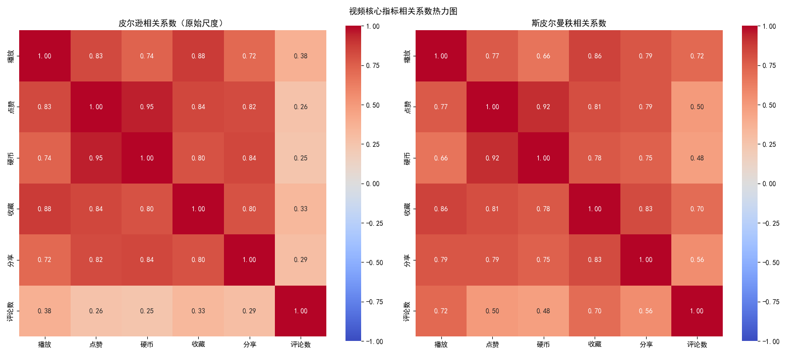

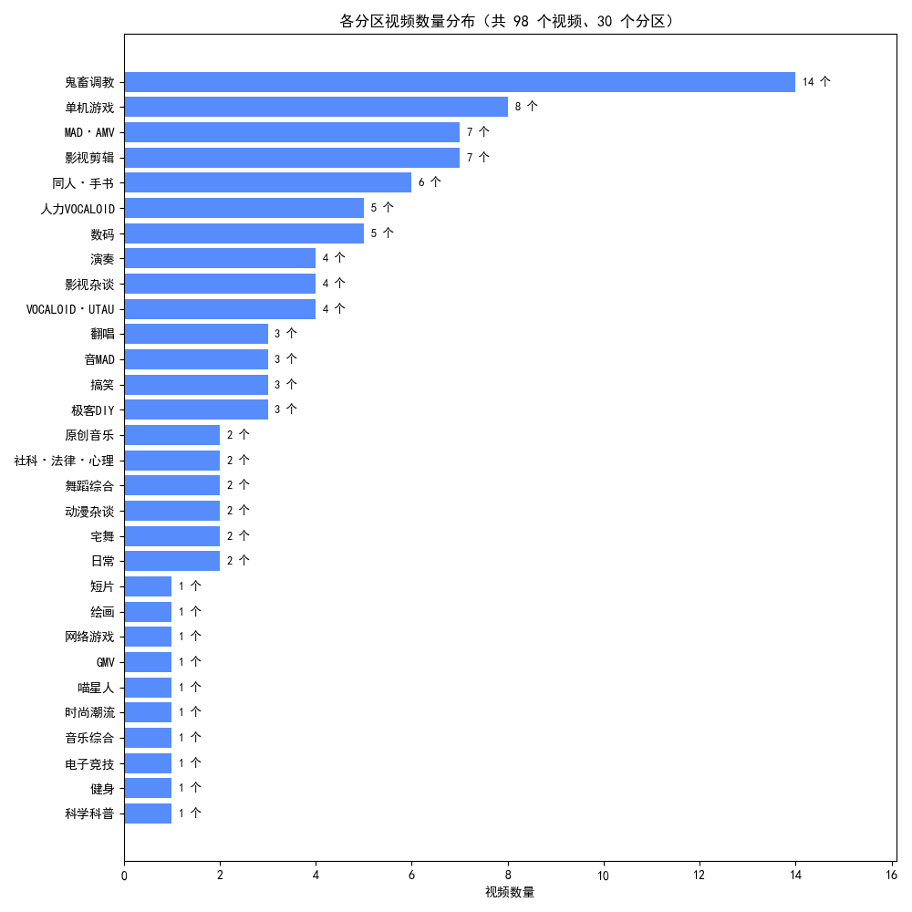

其余图表见 `data/fig/analysis/`：`播放量分布直方图.png`、`高播放量视频内部各分区样本占比.png`、
`不同分区视频的点赞率分布.png`、`各类互动率整体分布.png`、`各分区视频平均投币率.png`、
`点赞率与投币率散点图.png`、`不同播放量级别的平均评论点赞.png`、`评论长度分布.png`。

### 7.2 评论情感分类

**特征工程**：对评论做 jieba 分词后用停用词表过滤，构造两路 TF-IDF 特征并横向拼接：

| 特征 | 配置 | 作用 |
| --- | --- | --- |
| 词级 TF-IDF | `ngram_range=(1, 2)` + 停用词 | 捕捉词语级语义 |
| 字级 TF-IDF | `analyzer='char_wb'`，`ngram_range=(2, 3)`，`sublinear_tf=True`，`min_df=2`，`max_df=0.95` | 缓解分词误差与错别字、网络用语问题 |

拼接后特征矩阵为 **9061 × 435703** 维稀疏矩阵。数据集按 8:2 分层划分（`random_state=42`），
测试集 1813 条；考虑到样本不均衡，对支持 `class_weight` 的模型开启 `class_weight='balanced'`。

**（1）6 个模型默认参数下的结果**（测试集，n = 1813）：

| 模型 | 关键参数 | 准确率 | macro-F1 | 负面(0)召回 | 中性(1)召回 | 正面(2)召回 |
| --- | --- | --- | --- | --- | --- | --- |
| **逻辑回归** | C=1.0，balanced | **0.6702** | **0.63** | 0.49 | 0.76 | 0.58 |
| SVM | LinearSVC，C=0.3，balanced | 0.6619 | 0.61 | 0.45 | 0.80 | 0.51 |
| 随机森林 | 300 棵树，balanced | 0.6613 | 0.61 | 0.43 | 0.80 | 0.52 |
| XGBoost | 300 轮，multi:softmax | 0.6365 | 0.60 | 0.55 | 0.71 | 0.55 |
| KNN | k=10，cosine | 0.6260 | 0.55 | 0.33 | 0.83 | 0.40 |
| 朴素贝叶斯 | alpha=0.1 | 0.6045 | 0.59 | 0.66 | 0.55 | 0.68 |

**（2）网格搜索 + 分层 5 折交叉验证**（`StratifiedKFold(n_splits=5, shuffle=True, random_state=42)`，
评分口径为交叉验证平均准确率）：

| 模型 | 搜索出的最优参数 | 5 折 CV 最优评分 | 测试集准确率 |
| --- | --- | --- | --- |
| SVM | C=0.3，balanced | 0.6592 | 0.66 |
| 逻辑回归 | C=1，balanced | 0.6562 | 0.67 |
| 随机森林 | 300 棵树，max_depth=None（不限深），balanced | 0.6381 | 0.66 |
| 朴素贝叶斯 | alpha=1.0（默认） | 0.6378 | 0.56 |
| KNN | n_neighbors=20，cosine | 0.6217 | 0.62 |
| XGBoost | 300 轮，max_depth=5，learning_rate=0.1 | 0.5692 | 0.63 |

调参后的最优估计器另存为 `model/ml/{模型名}_best.pkl`。

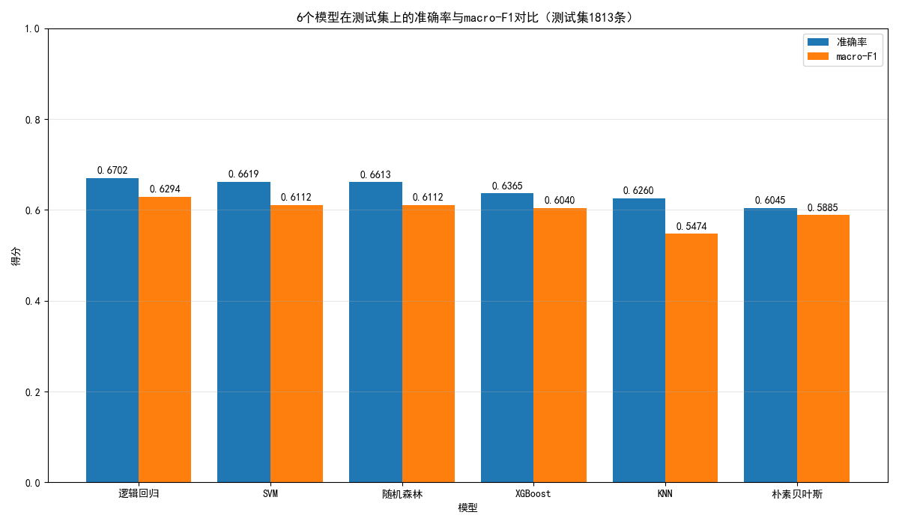

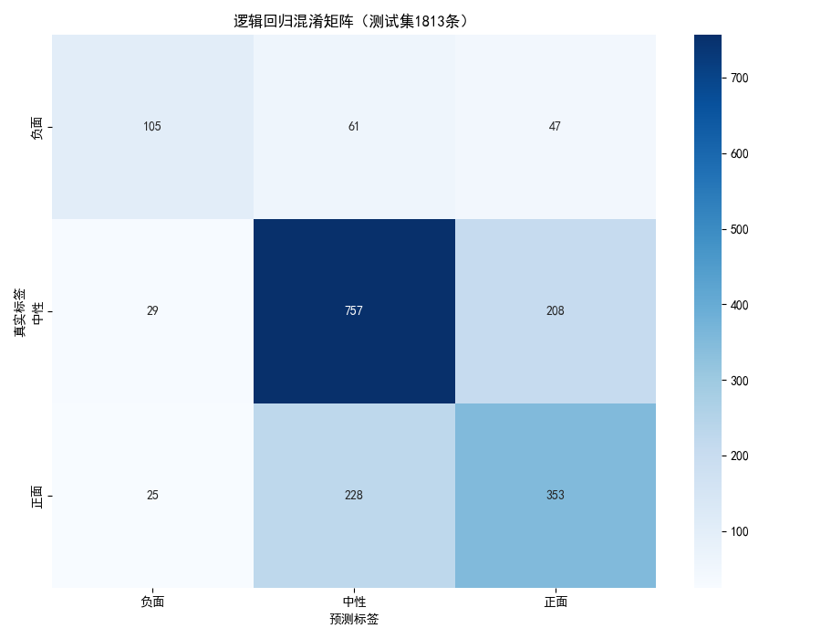

上面两张图由已保存的 `model/ml/*.pkl` 直接在测试集上预测生成，
测试集与建模脚本完全一致（同样的 TF-IDF 特征、同样的 `random_state=42` 分层划分），因此图和表中的数字严格对应。

**结果解读**：

1. **线性模型和随机森林表现最好**：逻辑回归（0.6702）领先，SVM（0.6619）与随机森林（0.6613）几乎打平。
   评论情感分类中起决定作用的是关键词的强弱（如「喜欢」「感动」vs「恶心」「失望」），
   这类近似线性的信号正好是线性模型的强项；而 TF-IDF 是高维稀疏特征，KNN 容易被距离度量拖累，
   XGBoost 在这种特征下也没有占到便宜。
2. **模型间的强项不同**：朴素贝叶斯的负面类召回最高（0.66），逻辑回归综合最均衡（macro-F1 0.63）。
   如果业务上更在意「别漏掉负面评论」，可以按召回优先选模型。
3. **网格搜索后数值变低是正常现象，不是模型退化**：CV 平均分与单次测试集准确率是两个口径，
   ±2% 的波动属于正常范围；且搜索出的最优参数基本与默认参数一致（逻辑回归仍是 `C=1`，
   随机森林也选中了默认的「300 棵树 + 不限深度」），说明默认参数已接近这组特征下的最优区间，
   模型瓶颈不在超参数上。
   另外要注意口径差异：XGBoost 与朴素贝叶斯没有 `class_weight`，搜索时是把类别权重作为 `sample_weight`
   传给 `fit` 的，而 sklearn 会把这个参数一并交给评分器，所以这两个模型的 CV 分数实际是**加权准确率**，
   与另外 4 个模型的普通准确率不完全同口径；跨模型比较时以测试集准确率与 macro-F1 为准。
4. **真正的瓶颈是数据而非模型**：
   - 类别不均衡严重：负面类只有 1063 条，各模型对负面类的召回普遍偏低（KNN 0.33、随机森林 0.43、SVM 0.45），
     大量边界样本被吸进「中性」这个大类；
   - 人工标注的三分类口径本身存在模糊地带，「中性」中包含大量玩梗打卡类长尾评论，与正面/负面边界重叠；
   - 结论：在现有搜索空间里继续调参收益有限（逻辑回归、SVM 搜出的最优参数与默认值完全一致），
     提升空间主要在数据侧（补充负面样本、细化标注规范）与特征侧。

**（3）模型打包与预测**

`hot_comment_ml.py` 在训练结束后会把**两个 TF-IDF 向量器**和准确率最高的**逻辑回归模型**打包成一个文件
`model/ml/评论情感分类.pkl`。这样模型就能直接用在没见过的评论上——新评论用同一套向量器转成特征，
再交给模型预测即可：

```bash
cd src/hot_video_comment_ml
python hot_comment_predict.py
```

```
评论：这期视频的文案太好了，看几遍都不够
预测情感：正面（逻辑回归模型，label=1）

评论：越来越失望了，完全没有以前的感觉
预测情感：负面（逻辑回归模型，label=-1）

评论：2026年来考古，有人吗
预测情感：中性（逻辑回归模型，label=0）
```

### 7.3 评论主题聚类

**整体词频**：剔除停用词与空白符号后，评论区出现次数最多的 10 个词是
「都（3305）、不（2998）、人（2653）、视频（2417）、看（2233）、说（2136）、…（1946）、很（1627）、弹幕（1475）、没有（1428）」，
以口语化的泛用词和情绪词为主，说明热门评论区整体处在「随口互动」的语境里，这也和后面「玩梗打卡」类评论占一半以上相互印证。


**流程**：分词去停用词后构造词级 + 字级 TF-IDF → `TruncatedSVD(n_components=100)` 降维 →
`normalize()` 行归一化（把每条评论压成单位向量，让 KMeans 的欧氏距离等价于余弦距离）→ `KMeans(n_init=10)`。

**k 值选择**：用 SSE 肘部法则、轮廓系数 SC、CH 指数三条曲线在 `k = 2～9` 上评估。
三个指标都没有出现明确拐点（这是文本高维稀疏数据的常见情况，且长尾评论较多），
因此结合「主题可解释性」确定 **k = 5**。

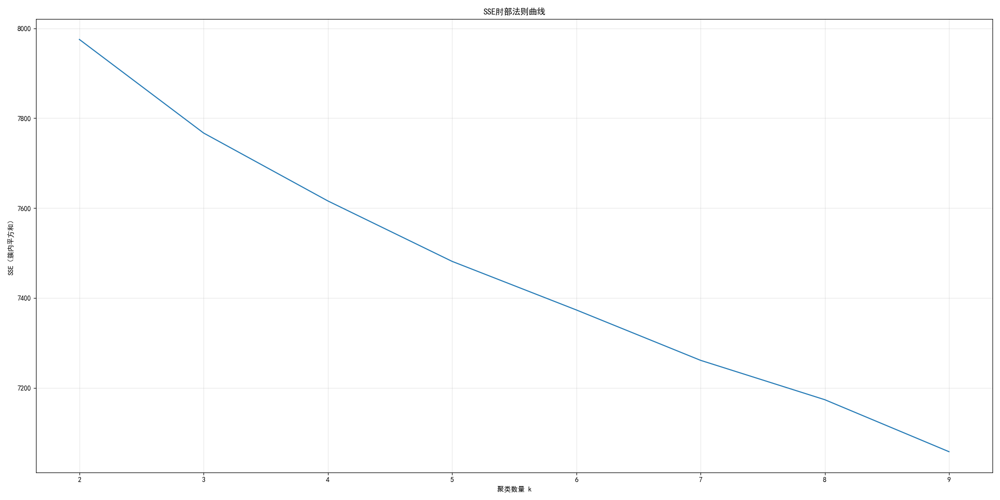

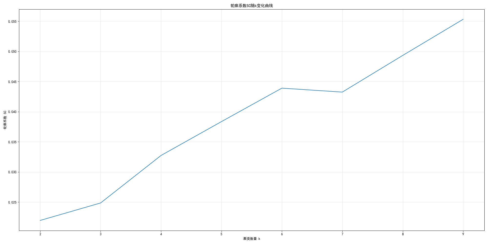

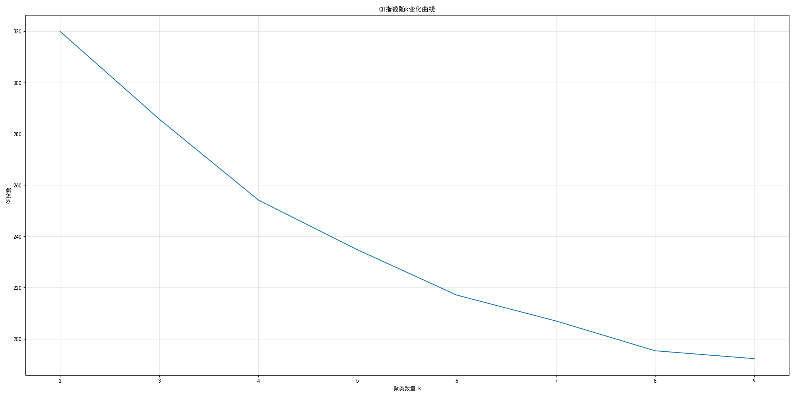

**k = 5 时各簇的主题词与命名**（从各簇词频 Top10 中剔除过于通用的词后展示）：

| 簇 | 样本量 | 占比 | 主题词 | 主题命名 |
| --- | --- | --- | --- | --- |
| 簇 2 | 4915 | 54.2% | 哈哈哈、12、02、基佬、00、10、pdd、小丑 | 玩梗打卡 |
| 簇 0 | 2499 | 27.6% | 一种、一天、文化、别人、当时、诸葛亮、成为 | 长篇感想与价值观讨论 |
| 簇 4 | 789 | 8.7% | 同学、内容、当时、粉丝、剪辑、白鼠、网站、朋友 | 视频内容评价 |
| 簇 1 | 445 | 4.9% | 高级、举报、保护、意义、新人、手机、屏蔽、挤掉、礼仪 | 弹幕礼仪 |
| 簇 3 | 413 | 4.6% | UP、吃货、关注、粉丝、谢谢、系列 | UP 主互动 |

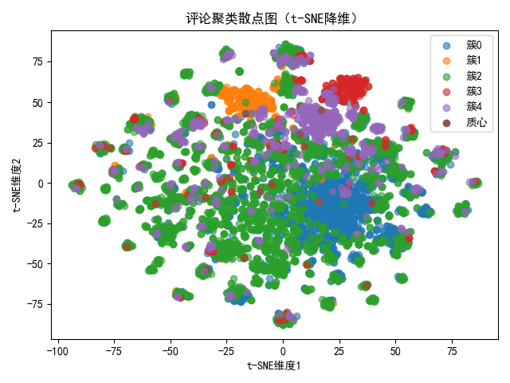

**结论**：

1. 评论区的讨论高度集中在「玩梗打卡」上，占了一半以上，说明热门视频评论区的主要功能是情绪宣泄与玩梗互动，
   而非内容讨论。
2. 聚类结果与人工情感标签的一致性很低（ARI ≈ 0.05，NMI ≈ 0.03），
   说明**簇划分的是「话题」，不是「情感」**——同一个话题下正负评论混杂，两者是两个正交的维度，不应互相替代。
3. 各簇的情感构成差异明显：弹幕礼仪簇的负面评论占比最高（45.6%），
   而长篇感想、UP 主互动等簇以正面为主（正面占比 39.9%～43.1%），
   说明「弹幕礼仪」是评论区矛盾最集中的话题。

### 7.4 大模型微调（LoRA + Qwen2.5-0.5B）

把同样的 9061 条标注评论做成对话格式（system 说明角色 / user 给评论 / assistant 只回答一个情感词），
用 6523 条训练、725 条验证，**剩下 1813 条与 7.2 的测试集完全同一批**（`test_size=0.2, random_state=42, stratify=label`），
所以四组分数可以直接比较：

| 模型 | 准确率 | macro-F1 | 负面 F1 | 中性 F1 | 正面 F1 |
| --- | --- | --- | --- | --- | --- |
| 基座 Qwen2.5-0.5B（未微调，前 300 条） | 0.5433 | — | — | — | — |
| **LoRA 微调（1813 条）** | **0.6415** | **0.6246** | 0.5942 | 0.6904 | 0.5891 |
| TF-IDF + 逻辑回归（1813 条） | 0.6702 | 0.6294 | 0.5645 | 0.7422 | 0.5815 |

- **只训了 0.44% 的参数**（2,162,688 / 496,195,456），适配器文件 8.3 MB，训练 1224 步、约 44 分钟。
- 微调把 0.5B 模型的准确率从 54.3% 提到 64.2%（**+9.8 个点**），macro-F1 与机器学习基线几乎持平（0.6246 vs 0.6294）。
- 但准确率仍比 TF-IDF 低 2.9 个点：0.5B 的容量就是上限，继续调参收益不如换更大的基座。
- 有意思的是两边的错误方向不同：微调模型负面类**召回更高**（0.6291 vs 0.4930），
  TF-IDF 中性类更强（0.7616 vs 0.6429），两者预测一致率只有 0.6619，融合起来还有空间。
- 训练曲线：`train_loss` 0.2946；验证损失 0.2841 → 0.2802 → 0.3031（第 1/2/3 轮），从第 3 轮开始过拟合，因此最终取 2 轮。

训练过程中踩到的三个坑：

- 新版 `transformers` 删掉了 `warmup_ratio`，只能改写成 `warmup_steps`（按总步数的 10% 估一个值）；
- 拼 `labels` 时不能只给提示部分填 `-100`，还得先把提示截断到 `max_length - 答案长度`，
  否则 `labels` 会比 `input_ids` 长，训练直接报错；
- `PeftModel.from_pretrained()` 会把 LoRA 层直接注入基座对象，之后再用「基座」预测其实还带着 LoRA，
  测微调前的水平必须临时关掉：`with lora_model.disable_adapter():`。

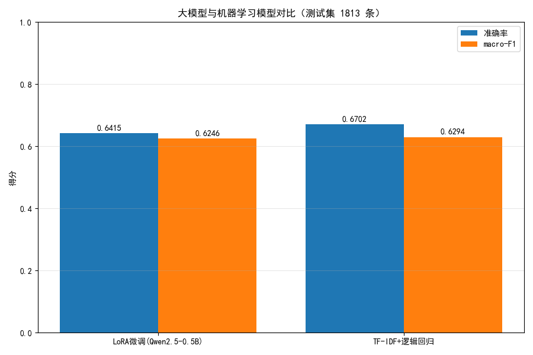

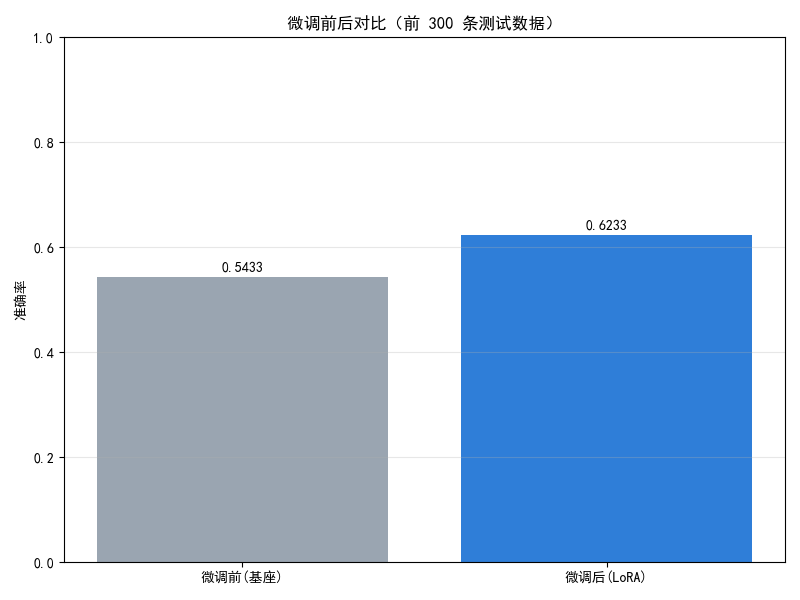

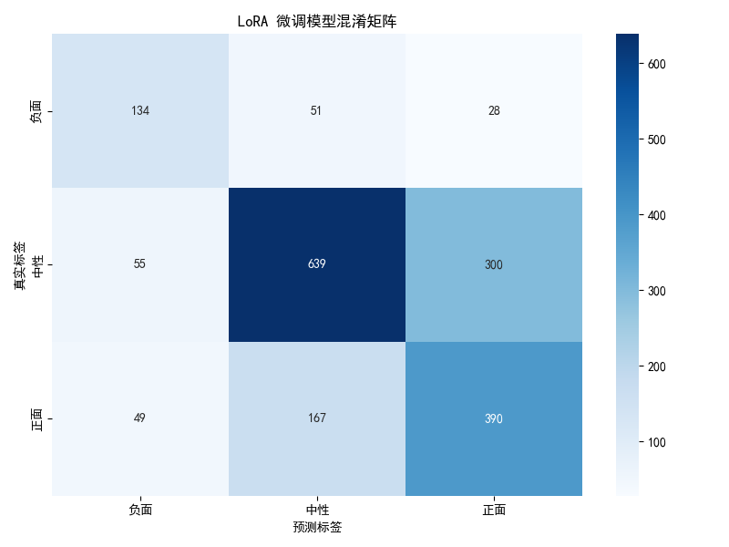

### 7.5 深度学习基线（TextCNN）

自己搭的 TextCNN（jieba 词表 9998 词、`max_len=64`、`embed_dim=64`、2/3/4 三种卷积核各 100 个、5 轮）：

| 模型 | 准确率 | macro-F1 |
| --- | --- | --- |
| TextCNN | 0.6365 | 0.5669 |
| LoRA 微调 | 0.6415 | 0.6246 |
| TF-IDF + 逻辑回归 | 0.6702 | 0.6294 |

- 准确率不算差，但 **macro-F1 只有 0.5669**：负面类召回仅 0.3099（213 条只认出 66 条），
  样本不均衡下模型整体倒向「中性」。验证集准确率在第 3 轮达到 0.6386 后基本走平，瓶颈主要是样本量与词向量质量。
- 结论：从零训练的小卷积网络在 9061 条样本上打不过 TF-IDF，数据量是主要瓶颈；
  这也说明「传统特征工程 + 线性模型」在小样本中文短文本上仍然是很难越过的基线。

网络结构（只用 `torch` + `jieba`，没有用预训练词向量）：

```
评论 → jieba 分词 → 查词表编号（最多 1 万个词，其余记 0）→ 统一截断/补齐到 64 个词
     → Embedding(10000 × 64)
     → 三路一维卷积（窗口 2 / 3 / 4，各 100 个卷积核）
     → 每路最大池化 → 三路拼成 300 维 → Dropout → 全连接 → 3 类
```

- 三种卷积窗口 2/3/4：一条评论的情感常由几个词的组合决定（「太 好看 了」「浪费 时间」），
  同时用三种长度的窗口去扫，让网络自己学哪种词组更有用；最大池化则保证不管评论长短，输出维度都固定。
- 没有用 `nn.Module`：参数放在一个 dict 里（`init_params()` 建词向量、三组卷积核和全连接层，
  再统一包成 `torch.nn.Parameter`），前向传播用 `torch.nn.functional` 里的 `embedding` / `conv1d` / `linear` 手写，
  优化器直接拿 `params.values()`。保存时 `torch.save()` 存这个 dict（只存权重，2.7 MB），
  加载用 `torch.load()` 取回即可，不需要先建模型结构。
- 随机种子固定在 `init_params()` 里（`torch.manual_seed(42)` / `np.random.seed(42)`），
  固定的是词向量初始化和每轮的打乱顺序；但 GPU 上卷积的反向传播不保证逐位一致，
  同一份代码重复跑测试集准确率会在 **0.61～0.63** 之间波动（macro-F1 约 0.53～0.56，最多差约 2 个点），所以表里按一次实测记录。

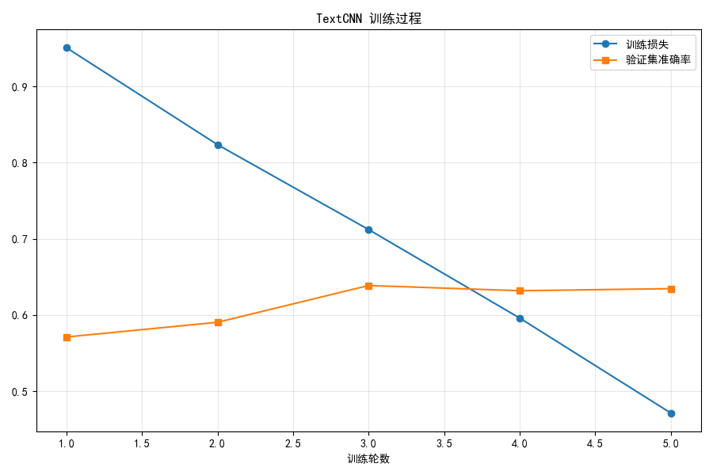

### 7.6 检索增强问答（RAG）

- **索引**：9061 条评论 → 字级 TF-IDF（`char_wb` 2–4 元，281,515 维），存到 `model/rag/`。
- **纯余弦检索的失败案例**（值得记录）：问「二舅」返回的是含「感受」二字的无关评论，问「新宝岛」返回《极乐净土》——
  问题里的「评论」「相关」这类高频词贡献了太多字面相似度。
- **改进**：先 jieba 切词、统计每个词的文档频率 `df`，只保留 `0 < df <= 60` 的稀有词，
  再只在「含稀有词」的候选子集里算余弦。修正后同一批问题的命中情况：

  | 问题 | 候选数 | 结果 |
  | --- | --- | --- |
  | 二舅 | 44 | 全部来自《回村三天，二舅治好了我的精神内耗》 |
  | 新宝岛 | 15 | 全部命中猛男版新宝岛 |
  | 弹幕礼仪 | 47 | 命中真实的弹幕礼仪吐槽 |

- **作答**：检索到的评论拼成材料塞进 prompt，由大模型只根据这批材料回答，就是「检索 → 增强 → 生成」的完整 RAG 链路。
- **用 LangChain 的 LCEL 串起来**（代码在 `src/hot_video_comment_rag/hot_comment_rag.py` 的 `build_chain()`）：

  ```python
  chain = (
      {'context': retriever | RunnableLambda(format_docs), 'question': RunnablePassthrough()}
      | prompt            # 提示词：材料 + 人话问题
      | llm               # ChatOpenAI，temperature=0
      | StrOutputParser() # 取出纯文本
  )
  ```

  检索器是自己写的 TF-IDF 余弦，用 `RunnableLambda` 包一下就能接进链；检索结果用 LangChain 的 `Document`
  传（正文放 `page_content`，视频标题 / 情感 / 点赞数放 `metadata`），以后换成真正的向量库时下游不用改。

### 7.7 工具调用 Agent

5 个普通函数（情感统计 / 评论检索 / 视频排序 / 视频详情 / 情感预测）用 `StructuredTool.from_function()`
包成 LangChain 工具（参数 JSON Schema 由函数签名自动生成），再用三块积木搭成 Agent：

```python
prompt = ChatPromptTemplate.from_messages([
    ('system', '你是B站视频评论区数据分析助手，优先调用工具拿真实数据。'),
    ('human', '{input}'),
    MessagesPlaceholder('agent_scratchpad'),      # 放「调了哪个工具、返回了什么」
])
agent = create_tool_calling_agent(llm, tools, prompt)   # 每轮可选：调工具 or 直接回答
executor = AgentExecutor(agent=agent, tools=tools, verbose=True, max_iterations=3)
```

`AgentExecutor` 负责那个「想 → 做 → 看结果 → 再想」的循环，`max_iterations=3` 防止它无限调工具。
大模型根据问题自己决定调哪个工具、填什么参数，工具返回的结果再交回模型，最后由模型写成一段回答。

实测：

| 问题 | Agent 的回答 |
| --- | --- |
| 哪个视频的播放最高 | 《赵本山念诗之王》BV1bW411n7fY，播放 129,001,047（第 2《敢杀我的马》128,691,660、第 3《派大星的独白》94,661,344） |
| 负面评论有多少条 | 9061 条中负面 1063（11.7%）、中性 4968（54.8%）、正面 3030（33.4%） |
| 二舅那个视频数据怎么样 | 命中「二舅」相关评论 3 条，最高一条 187,751 赞 |
| 帮我判断这条评论的情感：这期视频太好看了 | 正面（置信度 0.7622，由 `评论情感分类.pkl` 给出） |

> 置信度 0.7622 是逻辑回归 `decision_function` 过 softmax 得来的；三分类任务里 0.33 才是「瞎猜」，
> 0.76 已经是明确倾向。直接调 `predict_proba()` 会报错，因为模型文件是老版本 sklearn 存的（见「已知问题」）。

## 八、已知问题与改进方向

**代码层面**

- 爬虫中视频接口的 `w_rid`/`wts` 与评论接口的 MD5 盐值是直接写死的，长时间后可能失效，
  规范做法是先从 `nav` 接口获取 `img_key`/`sub_key` 再实时计算 wbi 签名；
- 爬虫未校验接口返回的 `code` 字段，缺少 `timeout` 与失败重试，`except` 未指定异常类型，
  CSV 以 `'w'` 模式写入会覆盖历史数据；
- 爬虫里的 `Cookie` 需要换成自己的（脚本中现在是占位符）；
- `model/ml/` 目录下 12 个训练模型合计约 385 MB（含打包文件后整个目录约 406 MB；随机森林的默认与调参后两个文件各约 135 MB，都超过 GitHub 单文件 100 MB 限制），已加入 `.gitignore`，需要时运行训练脚本重新生成；预测用的 `评论情感分类.pkl`（约 21 MB）体积较小，已随仓库发布；
- `model/ml/评论情感分类.pkl` 是老版本 sklearn 存的，新版（1.7.2）里 `LogisticRegression` 已经没有
  `multi_class` 属性，直接调 `predict_proba()` 会报 `AttributeError`。`hot_comment_predict.py` 只用 `.predict()` 所以没受影响；
  新增的 Agent 工具里改用 `decision_function()` 过 softmax 自己算概率。根治办法是用当前版本重新训练并保存模型。
- 对外展示统一使用脱敏后的 `hot_comments_anonymized.csv`、`hot_comments_clean_anonymized.csv`；
  含真实用户名与 UID 的 `hot_comments.csv`、`hot_comments_clean.csv` 已加入 `.gitignore`，不随仓库发布。

**数据与建模层面**

- 评论样本是「热门评论前 100 条」的热度抽样（覆盖率约 0.4%），存在**热度偏置**：
  低赞但代表性强的情感表达可能根本没被采到，负面 / 极端情绪的比例存在被低估的风险；
- 样本不均衡（负面类仅占 11.7%）导致各模型对负面类的召回普遍偏低（0.25～0.66），
  可尝试过采样 / 欠采样，或引入情感词典特征；
- 文本特征已从纯 TF-IDF 扩展到 TextCNN 与 LoRA 微调（见 7.4 / 7.5），但在 9061 条样本上都没超过 TF-IDF 基线，
  主要瓶颈是数据量与显存（本机 6 GB 只能跑 0.5B）；
- 单条评论没有上下文：像「从 s13 一路看到 s8 你将得到一种升华」这种反讽/圈内梗，模型只能凭字面判断（实测判成中性），
  引入视频标题、UP 主、前后楼层等上下文可能比换模型更有效；
- 聚类 k 值缺少客观拐点支撑，可补充层次聚类、LDA 主题模型做交叉验证。

**大模型部分**

- 0.5B 基座是显存妥协的结果（6 GB 显存跑不了 7B 的 LoRA，fp16 全量微调 7B 需要 100 GB 以上），
  换 `Qwen2.5-1.5B-Instruct` 是当前性价比最高的一步（约 3 GB 权重、训练约 70 分钟）；
- RAG 的检索仍然是词面匹配（字符 n-gram + 稀有词过滤），同义改写（「二舅」vs「舅舅」）召不回来，
  换句向量模型（如 `text2vec-base-chinese`）会更稳，但要多下几百 MB 并重新建索引；
- Agent 的工具只有 5 个、也都是本地函数，离「能自己规划多步任务」还有距离；
  另外它依赖外部 API Key，没有 Key 就跑不起来。

## 九、后续计划

- [ ] 爬虫改造：实时计算 wbi 签名、Cookie 外置，增加超时重试与异常处理
- [ ] 评论扩容采集：抓取更多页、按时间排序的评论，降低只取前 100 条热门评论带来的热度抽样偏置
- [ ] 微调基座升级到 `Qwen2.5-1.5B-Instruct`，并把 LoRA 模型与 TF-IDF 做加权融合（两者一致率仅 0.66，互补性明显）
- [ ] RAG 检索换成中文句向量 + 向量库（faiss），支持同义改写检索；接入时只需把 `RunnableLambda` 换成 `vectorstore.as_retriever()`，链路其余部分不动
- [ ] Agent 增加「多步规划」演示（比如先查播放最高视频、再查它评论里的负面占比），并把 `max_iterations` 放开到 6
- [ ] 把「中性」进一步拆成玩梗类与信息类，验证能否提升三分类的区分度

## 十、许可

- 代码以 **MIT** 协议开源，详见 `LICENSE`；
- 数据仅用于学习与研究，不作商业用途；引用或转载本项目的数据与结论请注明来源。
